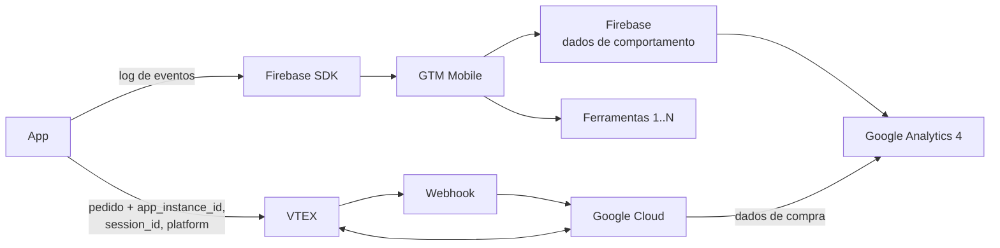

import Kicker from '@site/src/components/Kicker';
import Chip, {Chips} from '@site/src/components/Chip';

<Kicker>Geral · Dados</Kicker>

# Arquitetura de dados dos apps (2025)

O app só loga eventos no **Firebase**. O **GTM Mobile** intercepta esses eventos e distribui para as ferramentas; as compras chegam ao GA4 por um webhook da VTEX. Resumo do material da i-Cherry de 2025.

<Chips>
  <Chip tone="amber">Firebase</Chip>
  <Chip tone="blue">GTM Mobile</Chip>
  <Chip tone="teal">GA4</Chip>
  <Chip>VTEX</Chip>
</Chips>

## Fluxo

## SDKs

| Tipo | Quais | Papel |
|---|---|---|
| Essenciais | Firebase, GTM Mobile | Firebase coleta e "seta" os eventos; o GTM intercepta e envia às ferramentas, evitando atualizar o app a cada mudança |
| Secundários | SDK de cada ferramenta | Coletam dados exclusivos do serviço e permitem a integração via GTM |

## Quem faz o quê

| Etapa | Responsável |
|---|---|
| Garantir as funcionalidades de cada plataforma (SDKs no app) | Dev (time de apps) |
| Enviar os eventos Firebase que o GTM vai usar | Dev (time de apps) |
| Orquestrar no GTM o envio dos eventos logados para cada ferramenta | i-Cherry |
| Firebase recebe os eventos e integra com o GA4 | — (automático) |
| Enviar `app_instance_id`, `session_id` e `platform` junto ao pedido | Dev (time de apps) |
| Configurar o webhook, consultar a API da VTEX, montar o payload e enviar ao GA4 | i-Cherry |

## Regras para o time de apps

- **Novos SDKs** e **novos eventos** precisam ser implementados no código do app.
- **Eventos existentes** podem ser alterados via GTM, sem release.
- O envio para outras plataformas é feito **via GTM**, com base nos eventos que já existem.
- No app, implementar **apenas eventos Firebase**.
- `app_instance_id` e `session_id` no pedido é o que liga a compra ao source/medium da sessão no GA4.

## Measurement Protocol (web, para comparação)

- **Antes:** GTM client-side → GTM server-side (dados de terceiros) → GA4; os pedidos iam da VTEX para o Google Cloud e eram enviados em lote ao GA4.
- **Em testes (2025):** GTM server-side com domínio próprio (dados primários) + webhook da VTEX → Google Cloud → GA4, com `client_id` e `session_id` atrelando o source/medium.
- **Resultado do teste (06/12 a 12/12):** 20.476 pedidos na VTEX × 20.456 no GA4 — 99,9% de match, 10,2% de *not set*.

:::note
O material original (PDF da i-Cherry) é confidencial e fica só no [Notion](https://app.notion.com/p/6dfbe2d3047e4245a4a6a0f6d34af9cc). Para validar eventos no app, use o [Debug Menu](./debug-menu.mdx).
:::
