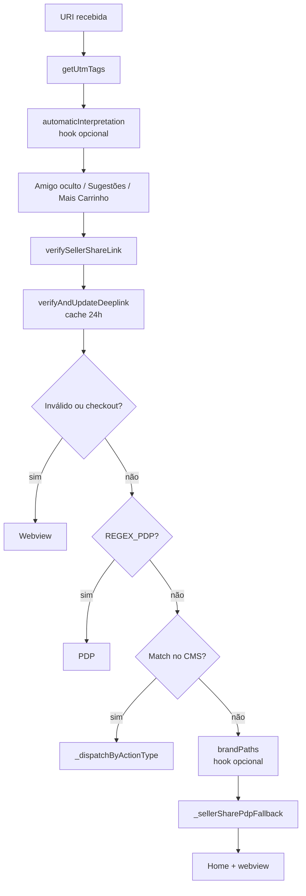

import Kicker from '@site/src/components/Kicker';
import Chip, {Chips} from '@site/src/components/Chip';

<Kicker>Geral · Deeplinks</Kicker>

# Deeplinks

Lado técnico dos deeplinks: como o app processa o link recebido, os pontos de extensão por marca, o setup nativo (iOS/Android), como testar e as particularidades de cada app. O cadastro dos links fica no Strapi: [Coleção Deeplinks](../strapi/colecoes/deeplinks.mdx) e [componente Deeplink](../strapi/componentes/deeplink.mdx).

<Chips>
  <Chip tone="coral">Deeplink</Chip>
  <Chip tone="blue">azzas_app_commons</Chip>
  <Chip>Universal / App Links</Chip>
</Chips>

## Em 30 segundos

Para um deeplink abrir no app, três coisas precisam estar no lugar:

1. **iOS:** o path precisa estar no `apple-app-site-association.js` da marca (arquivo hospedado no site/VTEX).
2. **Android:** o path precisa estar no `AndroidManifest.xml` (também há arquivo no site, mas o manifest já basta).
3. **Redirecionamento:** o `DeeplinkHandler` e o `DeeplinkConfig` da marca resolvem para qual tela o link leva.

## Visão geral da arquitetura

O fluxo é **compartilhado entre todas as marcas**:

- **Handler único:** `azzas_app_commons/lib/modules/deeplink/deeplink_handler.dart` orquestra todo o pipeline.
- **Cadastro:** 100% via Strapi, no documento `deeplink-<marca>` (`deeplink-hering`, `deeplink-nv`, `deeplink-farm`…). Cada `DeeplinkCmsComponent` expõe `url` (match exato), `navigateTo` (rota dinâmica), `title`, `orderBy` e os campos estendidos `actionType` (`navigate`/`pdp`/`pdpFromPath`/`plp`/`webview`), `queryParamKey`, `urlMatchPattern` (regex de match) e `pathExtractPattern` (regex para extrair o id do path).
- **Customização por marca:** cada app declara um `DeeplinkConfig` no `app_config.dart`, sobre o contrato de `azzas_core/lib/config/deeplink_config.dart`. É o único ponto em que a marca injeta regras próprias.
- **Cache:** os deeplinks do CMS ficam em memória (`DeeplinkCubit`) e são revalidados a cada 24h (ou quando o cubit está vazio). O cache em storage está **desabilitado temporariamente** — toda abertura do app refaz o fetch.

## Pipeline de tratamento

`DeeplinkHandler.redirectFromURL` executa os passos **em ordem**. O bloco que redireciona lança `RedirectInterrupt` e encerra o pipeline.



1. **`getUtmTags(uri)`** — captura `utm_*` e grava nas marketing tags (`DeeplinkMarketingDataUseCase`).
2. **`automaticInterpretation`** *(hook opcional)* — resolve o link por inferência **antes** do match CMS (a Reserva consulta a árvore VTEX aqui).
3. **`verifyIsSecretFriend`** — path com `amigo-oculto` navega direto pela URL (Farm).
4. **`verifySuggestions`** — path com `sugestoes` navega direto pela URL (Farm).
5. **`verifyIsMoreCard`** — path com `maiscarrinho` **e** `?utm_source=maisvendas` monta o Mais Carrinho (`DeeplinkMoreCartUseCase`) e leva para `/mochila`.
6. **`verifySellerShareLink`** — links de vendedora em dois formatos:
   - **Lojinha de Vendedor (atual):** `?utm_source=maislojinha` monta `SellerShareCart` com `sellerCode` de `utm_campaign` e cupom de `?coupon`. O pipeline continua e abre a PDP; o `AzzasPdpSellerShareBottomSheet` confirma o cupom lá.
   - **Legado:** `?sellerShare=true` monta `SellerShareCart`. Com `?sellerSharePdp=true` o pipeline abre a PDP; sem, redireciona para `/mochila`.
7. **`verifyAndUpdateDeeplink`** — popula o `DeeplinkCubit` com os deeplinks do CMS quando está vazio ou com mais de 24h.
8. **`invalidDeeplinkHandler`** — se a URL (só path, sem query) bate com a lista de **deeplinks inválidos** do CMS, **ou** contém `checkout`, abre em **webview**.
9. **`pdpDeeplinkHandler`** — testa a URI contra o `REGEX_PDP` da marca. A resolução do `productId` varia por marca (ver abaixo).
10. **`validDeeplinkHandler`** *(Strapi, prioridade)* — procura um **deeplink válido** por igualdade (`url == normalizeUri(uri)`) ou por regex (`urlMatchPattern`). No match, despacha por `actionType`: `navigate`, `pdp` (id via `queryParamKey`), `pdpFromPath` (id via `pathExtractPattern`), `plp`, `webview`. Fallbacks internos: `simplifyUriForMatch` (NV) e `queryDeeplinkHandler`.
11. **`brandPaths`** *(hook opcional)* — paths da marca tratados em código (Farm `_secure/account`, Hering home raiz, NV `productClusterIds`).
12. **`_sellerSharePdpFallback`** — último recurso do formato legado: com `SellerShareCart` no cubit e `?sku=` na URI, abre a PDP.
13. **Fallback final** — nada bateu: troca para a aba Home e abre a URL em **webview**.

:::warning
O handler é tolerante a erro: qualquer exception fora de `RedirectInterrupt` cai num `debugPrint`. Valide manualmente toda alteração nos blocos do pipeline.
:::

## Pontos de extensão por marca (`DeeplinkConfig`)

Contrato em `azzas_core/lib/config/deeplink_config.dart`. Cada app declara o seu em `<marca>_app_flutter/lib/app_config.dart`.

**Campos obrigatórios**

| Campo | O que faz |
|---|---|
| `REGEX_PDP` | `RegExp` que identifica URLs de PDP da marca. Usado em `pdpDeeplinkHandler`. |
| `queryKeyOrderBy` | Nome do query param de ordenação (Hering usa `order`, Farm usa `sort`). Precedência: `deeplink.orderBy ?? uri[queryKeyOrderBy] ?? uri['sort']`. |
| `pdpMatchIdentifier` | Função `Uri → String?` que extrai o `productId`/slug da PDP. |

**Hooks opcionais**

| Hook | Quando roda | Uso atual |
|---|---|---|
| `automaticInterpretation` | **Antes** do match CMS, recebe `String url` | Reserva consulta a árvore VTEX |
| `brandPaths` | **Depois** do `pdpDeeplinkHandler`, recebe `Uri` | NV `productClusterIds`, Hering home raiz, Farm `/_secure/account` e `mais-lojinha.somalabs.com.br` |
| `onValidDeeplinkRedirect` | Quando um deeplink válido bate, recebe `navigateTo` | Farm alterna o modo ETC |
| `simplifyUriForMatch` | Fallback quando a URL exata não bate; retorna `Uri?` | NV reduz URIs com filtros no path |
| `transformPlpNavigateTo` | Dentro do `redirectToPlp`, recebe `(uri, navigateTo)` | NV injeta `filtro-de-cores`/`filtro-de-tamanhos` e o gate VIP `sc=5` |

## Query params lidos da URL

Valem independentemente do cadastro no CMS:

| Parâmetro | Efeito |
|---|---|
| `?order=` / `?sort=` | Sobrescreve a ordenação (precedência: `deeplink.orderBy` do CMS > query da URL) |
| `?title=` / `?titulo=` | Sobrescreve o título da PLP |
| `?utm_*` | Gravado como marketing tags |
| `?utm_source=maisvendas` + path `maiscarrinho` | Fluxo Mais Carrinho |
| `?sellerShare=true` | Fluxo legado de compartilhamento da vendedora |
| `?sellerSharePdp=true&sku=<id>` | Variante legada para PDP específica |
| `?utm_source=maislojinha` + `utm_campaign` + `coupon` | Lojinha de Vendedor (atual) |
| `?map=` *(só NV)* | Tipo de cada segmento do path (`c`, `category-N`, `cor`, `tamanho`, `productClusterIds`) |
| `?sc=5` *(só NV)* | Gate da coleção exclusiva VIP |

:::note
Ao montar o `navigateTo` final, o handler converte `title → titulo` e `order/sort → ordenacao` (`buildNavigateToUrl`).
:::

## Setup nativo

Universal/App Links em **HTTPS**. O scheme custom (`hrg://`, `nv://`) ficou só para teste local.

<details>
<summary><b>Android — AndroidManifest.xml</b></summary>

Uma entrada `<data>` por path (ou prefixo) que o app deve interceptar:

```xml
<data android:scheme="https" android:host="www.bynv.com.br" android:pathPrefix="/new-in" />
```

Prefira um `pathPrefix` curto que cubra uma família de URLs a cadastrar uma por uma.

</details>

<details>
<summary><b>iOS — apple-app-site-association.js</b></summary>

Arquivo hospedado na VTEX da marca; define quais paths abrem o app no iOS. Path fora do arquivo abre no Safari.

- **Hering:** arquivo restritivo, precisa atualizar a cada novo path. [Arquivo público da Hering](https://hering.vteximg.com.br/arquivos/apple-app-site-association.js).
- **NV:** wildcard (`*`), não precisa alterar.
- **Demais marcas:** verificar com a VTEX da marca; o contato muda por marca.

Quando precisar atualizar, **somos nós que enviamos o arquivo** para a VTEX substituir — mantenha cópia e versione com cuidado.

</details>

## Como testar um deeplink

Com o app instalado e em segundo plano:

<details>
<summary><b>Android (emulador ou device USB)</b></summary>

```bash
adb shell am start -W -a android.intent.action.VIEW -d "https://www.bynv.com.br/new-in" br.com.bynv
adb shell am start -W -a android.intent.action.VIEW -d "https://www.hering.com.br/camisa-feminina-plus-size" br.com.hering
```

Se não abrir, vá em **Configurações → Apps → [app da marca] → Open by default** e habilite o host (ex.: `www.bynv.com.br`).

</details>

<details>
<summary><b>iOS (simulador)</b></summary>

```bash
xcrun simctl openurl booted "https://www.bynv.com.br/new-in"
```

Pré-requisito: o path precisa estar no `apple-app-site-association.js` da marca.

</details>

<details>
<summary><b>Resetar o cache de deeplinks</b></summary>

O cubit guarda os deeplinks do CMS por 24h. Para forçar o refetch: desinstale e reinstale o app, ou limpe os dados do app nas configurações do sistema.

Hoje o cache em storage está desabilitado, então reabrir o app já refaz o fetch — mas o cubit mantém em memória durante a sessão.

</details>

<details>
<summary><b>Atalho: chamar o handler direto</b></summary>

Use só quando a base do link já abre o app (ex.: `www.bynv.com.br`). A partir daí tudo cai no handler, então dá para testar pelo método interno com um botão temporário:

```dart
InkWell(
  onTap: () {
    String urlTest = "insira aqui sua url";
    final deep = Modular.get<DeeplinkHandler>();
    deep.redirectFromURL(uri: Uri.tryParse(urlTest));
  },
  child: Container(height: 100, width: double.infinity, color: Colors.red),
),
```

Não commite esse botão.

</details>

## Especificidades por marca

<details>
<summary><b>Hering</b></summary>

- **Host:** `www.hering.com.br`.
- **PDP:** resolvida por **slug** via `GetProductBySlugUseCase` (o `pdpMatchIdentifier` extrai o slug; o handler busca o `productId` antes de navegar).
- **`brandPaths`:** path raiz/vazio → `home` (evita ficar parado em webview na home da marca).
- **`apple-app-site-association.js`:** restritivo, atualizar a cada novo path.
- **CMS:** documento `deeplink-hering`.

</details>

<details>
<summary><b>NV / BYNV</b></summary>

- **Host:** `www.bynv.com.br`.
- **PDP:** `REGEX_PDP` extrai o `productId` direto da URL.
- **URLs com filtros no path** (ex.: `/new-in/calcas/marrom/36?map=c,category-2,cor,tamanho`), tratadas pelo `NvDeeplinkHelpers`:
  - `simplifyUriForMatch` reduz a URL aos segmentos de categoria e tenta o match no CMS.
  - `transformPlpNavigateTo` propaga `cor` e `tamanho` do path para o `navigateTo` como `filtro-de-cores` / `filtro-de-tamanhos`. A URL recebida vence filtros estáticos do CMS.
- **`productClusterIds` dinâmico:** URLs com `?map=productClusterIds,...` **não precisam de cadastro** — `brandPaths` monta `plp/productclusterids/<id>`.
- **Coleção VIP (`?sc=5`):** detectada no `transformPlpNavigateTo`; delega ao `VipFlowCubit.enter(navigateTo)`, que orquestra o gate (VipFlowPage, doc do CMS, VIP/não-VIP/login, navegação final).
- **Ordenação:** lê `?order=<tipo>`. Sem `?order` (ou vazio), vale a ordenação manual da VTEX. Valores: `OrderByBestDiscountDESC`, `OrderByPriceASC`, `OrderByPriceDESC`, `OrderByReleaseDateDESC`, `OrderByNameASC`, `OrderByTopSaleDESC`.
- **`apple-app-site-association.js`:** wildcard, não precisa atualizar.
- **CMS:** documento `deeplink-nv`.

</details>

<details>
<summary><b>Farm</b></summary>

- **Host:** `www.farmrio.com.br`.
- **PDP:** `REGEX_PDP = r'(\d+(-\d+)?)\/p$'` (ex.: `/.../123456-78/p`).
- **`queryKeyOrderBy: ''`** — a Farm não passa ordenação padrão via deeplink (decisão da marca).
- **`brandPaths`:** `/_secure/account` e variantes vão para as telas equivalentes; `mais-lojinha.somalabs.com.br` abre direto em **webview** (sem troca de aba).
- **Lojinha de Vendedor:** usa o `AzzasPdpSellerShareBottomSheet` compartilhado (os legados `PdpSellerShareBottomSheet` / `PdpSellerShareEtcBottomSheet` foram removidos). Fluxo: `utm_source=maislojinha` → `verifySellerShareLink` monta `SellerShareCart` → PDP → bottom sheet → `DeeplinkSellerShareUseCase.handlerPdp` aplica cupom e código.
- **`onValidDeeplinkRedirect` (Farm ETC):** `navigateTo` com `etc` (`home_etc`, `menu_etc`, `pdp_etc`, `plp_etc`) seta `TransitionCubit.modeEtc = true`; senão `false`. A splash do ETC só aparece em `home_etc`.
- **Sugestões:** path com `sugestoes` é tratado em `verifySuggestions`, antes do match CMS.
- **CMS:** documento `deeplink-farm`.

</details>

<details>
<summary><b>Animale</b></summary>

- **Host:** `www.animale.com.br`.
- **PDP:** `pdpMatchIdentifier` extrai a referência (`X.Y.Z_W`) e o handler resolve via `IntelligentSearchUseCase`.
- Sem hooks opcionais.
- **CMS:** documento `deeplink-animale`.

</details>

<details>
<summary><b>Reserva</b></summary>

- **Host:** `www.usereserva.com`.
- **PDP:** `pdpMatchIdentifier` extrai o id; resolve via `IntelligentSearchUseCase`.
- **`automaticInterpretation`:** consulta a árvore de categorias da VTEX em runtime para links não cadastrados. Roda **antes** do match CMS.
- **CMS:** documento `deeplink-reserva`.

</details>

<details>
<summary><b>Maria Filó</b></summary>

- **Host:** `www.mariafilo.com.br`.
- **PDP:** `pdpMatchIdentifier` com regex próprio (group1 + group2 + group3).
- Só os campos obrigatórios do `DeeplinkConfig`.
- **CMS:** documento `deeplink-mariafilo`.

</details>

<details>
<summary><b>Cris Barros</b></summary>

- **PDP:** `pdpMatchIdentifier` retorna `<group1.upper>_<group2>`.
- Só os campos obrigatórios do `DeeplinkConfig`.
- **CMS:** documento `deeplink-crisbarros`.

</details>

<details>
<summary><b>Off Premium</b></summary>

- Mesmo modelo das marcas "básicas" (Animale/Maria Filó): só os campos obrigatórios.
- **CMS:** documento `deeplink-off`.

</details>

## Glossário

| Termo | Significado |
|---|---|
| `DeeplinkHandler` | Orquestrador do pipeline; único entry point do módulo |
| `DeeplinkCubit` | Cache em memória dos deeplinks do CMS + `isHandlingLink` + `sellerShareCart` |
| `DeeplinkConfig` | Contrato de extensão por marca (em `azzas_core`) |
| `DeeplinkCmsComponent` | Componente Strapi com `url`, `navigateTo`, `title`, `orderBy` e os campos estendidos (`actionType` default `navigate`). Os novos campos são opcionais. |
| `RedirectInterrupt` | Exception sentinela que encerra o pipeline após um redirecionamento |
| `MoreCart` | Carrinho da vendedora via "Mais Vendas" (`maiscarrinho` + `utm_source=maisvendas`) |
| `SellerShareCart` | Carrinho compartilhado por vendedora (`utm_source=maislojinha` ou `sellerShare=true`); guarda `sellerCode` e `coupon` |
| `normalizeUri` | Tira scheme, aplica lowercase e remove a barra final. Usado em **toda** comparação de URL do módulo |
