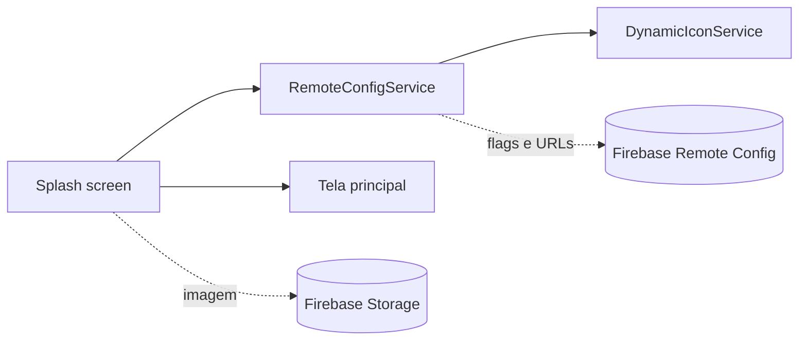

import Kicker from '@site/src/components/Kicker';
import Chip, {Chips} from '@site/src/components/Chip';

<Kicker>Geral · Ícones</Kicker>

# Troca dinâmica de ícone e splash

Como trocar o ícone do launcher e a splash **sem publicar nova versão**: ícones alternativos embarcados no build (Dynamic App Icons) e uma splash carregada de URL, os dois ligados pelo Firebase Remote Config.

<Chips>
  <Chip tone="amber">Remote Config</Chip>
  <Chip tone="blue">flutter_dynamic_icon</Chip>
  <Chip>Proposta · out/2025</Chip>
</Chips>

:::warning[Status]
Documento de solução escrito em outubro/2025. A flag `activate_new_icon` está registrada como **flag morta** na [página do Firebase](./firebase.mdx) — a troca dinâmica de ícone não está ativa nos apps. Hoje a splash remota é controlada por `splash_config` (mesma página). Para trocar ícone com release, veja [Alterar os ícones do app](./alterar-icones-do-app.mdx).
:::

## O que dá e o que não dá

| | Ícone do launcher | Splash |
|---|---|---|
| Trocar sem release | Sim, entre ícones **já incluídos no build** | Sim, qualquer imagem por URL |
| Controle remoto | Remote Config | Remote Config |
| Limites | Não dá para adicionar ícone novo sem rebuild. No iOS o sistema mostra um alerta "[App] changed its app icon" que não pode ser desligado; no Android a troca é silenciosa | Primeira carga baixa a imagem (precisa de internet); tamanho da imagem impacta o tempo |
| Persistência | Ícone permanece após restart | Cache com `CachedNetworkImage`, fallback para a splash local |

## Arquitetura



## Ícone dinâmico

Dependências:

```yaml
dependencies:
  firebase_core: ^2.24.2
  firebase_remote_config: ^4.3.8
  flutter_dynamic_icon: ^2.1.0
  shared_preferences: ^2.2.2
```

<details>
<summary><b>Android — activity-alias no AndroidManifest.xml</b></summary>

```xml
<application>
    <!-- Activity principal (ícone padrão) -->
    <activity android:name=".MainActivity" android:exported="true">
        <intent-filter>
            <action android:name="android.intent.action.MAIN"/>
            <category android:name="android.intent.category.LAUNCHER"/>
        </intent-filter>
    </activity>

    <!-- Alias para o ícone alternativo -->
    <activity-alias
        android:name=".MainActivityAlt"
        android:enabled="false"
        android:exported="true"
        android:icon="@mipmap/ic_launcher_alt"
        android:targetActivity=".MainActivity">
        <intent-filter>
            <action android:name="android.intent.action.MAIN"/>
            <category android:name="android.intent.category.LAUNCHER"/>
        </intent-filter>
    </activity-alias>
</application>
```

- O alias começa com `android:enabled="false"` e sempre aponta `targetActivity` para `.MainActivity`.
- Pode haver vários aliases, um por ícone.
- Assets: `ic_launcher_alt.png` em todas as pastas `mipmap-*dpi`.

</details>

<details>
<summary><b>iOS — CFBundleAlternateIcons no Info.plist</b></summary>

```xml
<key>CFBundleIcons</key>
<dict>
    <key>CFBundlePrimaryIcon</key>
    <dict>
        <key>CFBundleIconFiles</key>
        <array><string>AppIcon</string></array>
    </dict>
    <key>CFBundleAlternateIcons</key>
    <dict>
        <key>IconAlt</key>
        <dict>
            <key>CFBundleIconFiles</key>
            <array><string>IconAlt</string></array>
        </dict>
    </dict>
</dict>
```

No Xcode (`ios/Runner.xcworkspace`), crie `IconAlt.appiconset` em `Assets.xcassets` com todas as resoluções.

</details>

<details>
<summary><b>DynamicIconService</b></summary>

```dart
import 'package:flutter_dynamic_icon/flutter_dynamic_icon.dart';
import 'package:shared_preferences/shared_preferences.dart';

class DynamicIconService {
  Future<bool> hasChangedIcon() async {
    final prefs = await SharedPreferences.getInstance();
    return prefs.getBool('icon_already_changed') ?? false;
  }

  Future<bool> changeToAlternateIcon() async {
    try {
      if (Platform.isAndroid) {
        await FlutterDynamicIcon.setAlternateIconName('MainActivityAlt');
      } else if (Platform.isIOS) {
        if (!await FlutterDynamicIcon.supportsAlternateIcons) return false;
        await FlutterDynamicIcon.setAlternateIconName('IconAlt');
      }
      final prefs = await SharedPreferences.getInstance();
      await prefs.setBool('icon_already_changed', true);
      return true;
    } catch (e) {
      return false;
    }
  }

  Future<bool> resetToDefaultIcon() async {
    try {
      await FlutterDynamicIcon.setAlternateIconName(null);
      final prefs = await SharedPreferences.getInstance();
      await prefs.setBool('icon_already_changed', false);
      return true;
    } catch (e) {
      return false;
    }
  }
}
```

</details>

<details>
<summary><b>RemoteConfigService</b></summary>

```dart
class RemoteConfigService {
  final FirebaseRemoteConfig _remoteConfig = FirebaseRemoteConfig.instance;
  final DynamicIconService _iconService = DynamicIconService();

  Future<void> initialize() async {
    await _remoteConfig.setConfigSettings(RemoteConfigSettings(
      fetchTimeout: const Duration(seconds: 10),
      minimumFetchInterval: const Duration(hours: 1),
    ));
    await _remoteConfig.setDefaults({'activate_new_icon': false});
    await _remoteConfig.fetchAndActivate();
  }

  Future<void> checkAndChangeIcon() async {
    try {
      await _remoteConfig.fetchAndActivate();
      final shouldActivate = _remoteConfig.getBool('activate_new_icon');
      final alreadyChanged = await _iconService.hasChangedIcon();
      if (shouldActivate && !alreadyChanged) {
        await _iconService.changeToAlternateIcon();
      }
    } catch (_) {}
  }
}
```

Chamado no `initState` da tela principal: `initialize()` e depois `checkAndChangeIcon()`.

</details>

## Splash dinâmica

Dependências: `firebase_remote_config` e `cached_network_image`.

<details>
<summary><b>CustomSplashScreen</b></summary>

```dart
class CustomSplashScreen extends StatefulWidget {
  final Widget nextScreen;
  const CustomSplashScreen({super.key, required this.nextScreen});

  @override
  State<CustomSplashScreen> createState() => _CustomSplashScreenState();
}

class _CustomSplashScreenState extends State<CustomSplashScreen> {
  String? _splashUrl;

  @override
  void initState() {
    super.initState();
    _loadSplashAndNavigate();
  }

  Future<void> _loadSplashAndNavigate() async {
    try {
      final remoteConfig = FirebaseRemoteConfig.instance;
      await remoteConfig.fetchAndActivate();
      setState(() => _splashUrl = remoteConfig.getString('splash_screen_url'));
      await Future.delayed(const Duration(seconds: 2)); // tempo mínimo
    } finally {
      if (mounted) {
        Navigator.pushReplacement(
          context,
          MaterialPageRoute(builder: (_) => widget.nextScreen),
        );
      }
    }
  }

  @override
  Widget build(BuildContext context) {
    final url = _splashUrl;
    return Scaffold(
      backgroundColor: Colors.white,
      body: (url != null && url.isNotEmpty)
          ? CachedNetworkImage(
              imageUrl: url,
              fit: BoxFit.cover,
              width: double.infinity,
              height: double.infinity,
              placeholder: (_, __) => _defaultSplash(),
              errorWidget: (_, __, ___) => _defaultSplash(),
            )
          : _defaultSplash(),
    );
  }

  Widget _defaultSplash() => Center(
        child: Image.asset('assets/images/splash_default.png', fit: BoxFit.contain),
      );
}
```

</details>

## Configuração no Firebase

| Parâmetro | Tipo | Padrão | Uso |
|---|---|---|---|
| `activate_new_icon` | Boolean | `false` | Ativa o ícone alternativo |
| `splash_screen_url` | String | `""` | URL da imagem da splash |

Splash no **Firebase Storage**: crie `assets/splash/`, suba a imagem (ex.: `splash_v2.png`), libere leitura e copie a URL completa para `splash_screen_url`.

## Fluxo de ativação

1. **Antes:** o dev inclui os ícones alternativos e o código; o app é publicado com as flags desligadas.
2. **Ativar:** sobe a splash no Storage, preenche `splash_screen_url`, muda `activate_new_icon` para `true` e publica o Remote Config.
3. **Usuário:** na próxima abertura vê a splash nova; o fetch detecta a flag e troca o ícone em background.

## Boas práticas

- Remote Config: `minimumFetchInterval` de pelo menos 1h em produção (`Duration.zero` só em dev), sempre `setDefaults`, timeout de ~10s, fetch sem bloquear a UI.
- Splash: comprimir a imagem (até ~500 KB), PNG/JPG otimizado, sempre com fallback local.
- Ícone: controlar estado com `SharedPreferences` para trocar uma vez só; try/catch e logs.

## Testar

- **Ícone:** `minimumFetchInterval: Duration.zero`, ligar `activate_new_icon`, forçar `fetch()` + `activate()`, reiniciar o app.
- **Splash:** subir imagem de teste, atualizar a URL, limpar dados do app e abrir.
- **Resetar:** `prefs.clear()` e `FlutterDynamicIcon.setAlternateIconName(null)`.

| Problema | Causa provável |
|---|---|
| Ícone não troca | Flag ainda `false`; `icon_already_changed` já `true`; activity-alias errado (Android); asset ausente no Xcode (iOS) |
| Splash não carrega | URL inacessível; regras do Storage; rede |
| App trava na abertura | Operação bloqueando a main thread ou timeout longo — usar `.timeout(...)` |

## Referências

- [flutter_dynamic_icon](https://pub.dev/packages/flutter_dynamic_icon)
- [Firebase Remote Config — Flutter](https://firebase.google.com/docs/remote-config/use-config-flutter)
- [cached_network_image](https://pub.dev/packages/cached_network_image)
- [Android activity-alias](https://developer.android.com/guide/topics/manifest/activity-alias-element)
- [iOS alternate app icons](https://developer.apple.com/documentation/xcode/configuring-your-app-icon)
