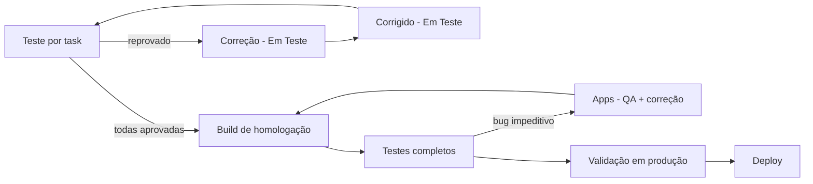

import Kicker from '@site/src/components/Kicker';
import Chip, {Chips} from '@site/src/components/Chip';

<Kicker>10b · Qualidade</Kicker>

# Testes de QA (manual)

Fluxo de testes do QA, da task individual até a aprovação para produção, com o roteiro de regressão por módulo e os templates de bug e aprovação. Complementa os [Testes E2E](./testes-e2e.mdx) automatizados.

<Chips>
  <Chip tone="teal">QA manual</Chip>
  <Chip tone="blue">Jira</Chip>
  <Chip tone="amber">Homologação</Chip>
  <Chip tone="coral">Produção</Chip>
  <Chip>iOS + Android</Chip>
</Chips>

## Em 30 segundos

1. **Teste por task:** testar contra os critérios de aceite. Aprovou → status **Testado** + comentário "Validação [Android/iOS] OK". Reprovou → **Correção - Em Teste** + template de bug.
2. **Correção:** dev corrige → **Corrigido - Em Teste** → QA retesta.
3. **Homologação:** com todas as tasks aprovadas, o dev publica a build no grupo **Daily & Pronto para homologar/subir**; o QA testa o app completo pelo [roteiro de regressão](#fase-4--testes-completos-de-homologação). Bug impeditivo → @Todos no **Apps - QA**. Não impeditivo → task nova.
4. **Aprovação final:** **confirmar que o app aponta para produção**, testar o essencial e comunicar a aprovação no grupo.



:::tip[Cupom de cancelamento automático]
Para pedidos de teste, use o cupom **Autocancel**.
:::

## Fase 1 · Testes por task

### Preparação

- Revisar a task no Jira: critérios de aceite, especificação, anexos, mockups.
- Confirmar o ambiente de teste (homolog/desenvolvimento) e se a task está no status certo.

### Execução

| Tipo | O que verificar |
|---|---|
| Funcionalidade básica | Funciona como especificado? Todos os critérios de aceite atendidos? Interface igual ao design? |
| Cenários alternativos | Erros tratados? Validações de entrada? Mensagens de erro claras? |
| Compatibilidade | Diferentes devices/resoluções, performance, nada existente quebrou |

### Resultado

- **Aprovado:** mover para **Testado** e comentar "Validação [Android/iOS] OK".
- **Reprovado:** comentar com descrição, passos, esperado × obtido, evidências e severidade (Crítico/Alto/Médio/Baixo); mover para **Correção - Em Teste** e marcar o dev responsável.

```text title="Template de bug (task)"
🐛 BUG ENCONTRADO
Severidade: [CRÍTICO/ALTO/MÉDIO/BAIXO]

Descrição: [Descrição clara do problema]

Steps para reproduzir:
1. [Step 1]
2. [Step 2]
3. [Step 3]

Resultado esperado: [O que deveria acontecer]
Resultado obtido: [O que realmente aconteceu]

Ambiente: [Dispositivo, versão, etc.]
Evidências: [Anexar screenshots/vídeos]

@[desenvolvedor] - Por favor, verificar e corrigir.
```

## Fase 2 · Correção

1. Task em **Correção - Em Teste**; o dev é notificado.
2. Dev corrige e move para **Corrigido - Em Teste**.
3. QA retesta com os mesmos critérios.

### Grupos no Teams

| Grupo | Quem | Para quê |
|---|---|---|
| **Daily & Pronto para homologar/subir** | Equipe ampla | Dev avisa build de homolog disponível; QA comunica aprovação/reprovação; aprovação final para produção |
| **Apps - QA** | PM, Tech Lead, dev que gera versões, QAs | Bugs impeditivos, correções urgentes, priorização, impedimentos técnicos |

- Bug crítico: mencionar no grupo na hora.
- Dúvida técnica: discutir antes de reportar.
- @Todos só em urgência.

## Fase 3 · Build de homologação

**Pré-requisitos:** todas as tasks da sprint aprovadas, nenhuma pendente de correção e OK do Product Owner.

Merge das features aprovadas → build de homologação com versão identificável (ex.: `v2.3.0-homolog`) → distribuição para o QA → aviso no grupo do Teams.

Como a build de homologação é cortada hoje (`release/X.Y.Z` a partir de `main`, feature flag para tirar feature reprovada): [Release da marca](./release-marca.mdx).

## Fase 4 · Testes completos de homologação

App inteiro com todas as features integradas, procurando bug de integração. Roteiro por módulo:

<details>
<summary><b>🏠 Home</b></summary>

- Todos os componentes (banners, vitrines, destaques…)
- Relógio de contagem regressiva (quando houver)
- Inserir e remover da Wishlist pela Home
- Acessar PLP pelos banners

</details>

<details>
<summary><b>🛍️ PLP / PDC</b></summary>

- Nome, valor e tags dos produtos (ex.: "Novo", "Promoção")
- Carrossel de imagens nos cards (quando houver)
- Filtros e ordenações
- Salvar e remover da Wishlist
- Relógio (quando houver)
- Voltar para a Home

</details>

<details>
<summary><b>📄 PDP</b></summary>

- Imagens, nome, valor, parcelamento e tags
- Salvar e remover da Wishlist
- Trocar a cor (quando houver variação) e selecionar tamanho
- "Avise-me" com item indisponível
- Tabela de medidas e medidas da peça (quando houver)
- Calcular frete
- Conteúdo "Sobre a peça"
- Ícone da sacola (mochila)
- "Leve o look" / "Combine com" (quando houver)
- Enviar e abrir um [deeplink](../geral/deeplinks.mdx) para a PDP
- Adicionar à mochila

</details>

<details>
<summary><b>🎒 Mochila (sacola)</b></summary>

- Remover produto (botão e slide)
- Alterar quantidade e tamanho
- Marcar/desmarcar como presente (inclusive com vários itens)
- Salvar na Wishlist por "Salvar pra depois" e "Slide Favoritar"
- Calcular frete
- Adicionar/remover cupom e código de vendedor
- Resumo da sacola
- Incluir/remover itens a partir da Wishlist
- Exclusão em massa (mínimo 5 itens)

</details>

<details>
<summary><b>💳 Checkout</b></summary>

- Entrar no checkout com produtos na sacola
- Adicionar e remover créditos
- Valor e exibição de cashback (quando houver)
- Resumo do pedido e cartões salvos
- Finalizar o pedido em cada cenário:

| Cenário | |
|---|---|
| CVV inválido | PIX |
| Cartão fake sem parcelamento | PIX parcelado |
| Cartão fake com parcelamento | PIX + cupom |
| Cartão fake + créditos | PIX + créditos |
| Cartão fake + cupom | Cartão novo (conferir se foi salvo) |
| Cartão fake + cupom + vale | |

</details>

<details>
<summary><b>📦 Pós-compra</b></summary>

- "Ver pedidos" / "Acompanhar pedidos"
- "Continuar comprando"

</details>

<details>
<summary><b>👤 Conta e login</b></summary>

- Login por e-mail válido, e-mail/senha inválidos, Google, Apple ID, biometria e convidado (os que existirem na marca)
- Dados do usuário logado
- Áreas: Meus pedidos e devoluções, Meus créditos, Notificações, Localização, Política de privacidade, Dúvidas, Versão do app
- Desabilitar biometria, logout e excluir conta

</details>

<details>
<summary><b>🔍 Busca e interações</b></summary>

- Lupa de busca e relevância dos resultados
- Gestos: remover por slide, remover por botão, movimentos horizontais rápidos
- Todos os itens da interface clicáveis
- "Avise-me" em diferentes pontos do app

</details>

<details>
<summary><b>🔗 Integrações (Strapi/CMS)</b></summary>

- Produtos, banners e vitrines carregando com dados reais do CMS
- Alterações no Strapi refletindo no app
- App apontando para **produção**, não homologação
- Internet instável: tratamento de erro

</details>

<details>
<summary><b>📱 Compatibilidade, performance e UI/UX</b></summary>

- Vários devices e tamanhos de tela, iOS e Android
- Tempo de carregamento e travamentos
- Wi-Fi e rede móvel (3G/4G/5G)
- Conferência visual: banners e imagens sem distorção, tipografia, cores, botões, alinhamentos, responsividade
- Navegação intuitiva e sem travamentos

</details>

### Bugs na homologação

| | Impeditivo | Não impeditivo |
|---|---|---|
| Critério | Impede o uso básico ou causa crash | Não impede o uso principal, mas precisa de correção |
| Ação | Reportar na hora; status "❌ BLOQUEADO - Bug Impeditivo" | Task separada no Jira; seguir os testes |
| Comunicação | @Todos no **Apps - QA** + task urgente | Reportar no Teams para discussão |
| Correção | Antes de seguir | Simples → entra na versão atual; complexa ou versão urgente → próxima versão |

```text title="Template de bug (homologação)"
🐛 BUG - TESTES DE HOMOLOGAÇÃO
Build: [versão]
Tipo: [IMPEDITIVO / NÃO-IMPEDITIVO]

Área afetada: [módulo/funcionalidade]
Descrição: [descrição detalhada]

Impacto: [descrição do impacto para o usuário]
Prioridade sugerida: [CRÍTICA/ALTA/MÉDIA/BAIXA]

Steps para reproduzir: [steps detalhados]
Evidências: [anexos]

Encontrado por: [QA]
Data: [data]
```

## Fase 5 · Validação final em produção

:::danger[Última etapa antes do deploy]
**Confirme que o app aponta para o Strapi de PRODUÇÃO.** Se estiver em homologação, **pare imediatamente** e avise no Apps - QA. Tire um print da configuração.
:::

- **Ambiente:** URL de produção configurada; o app conecta e os dados carregam. Para checar o ambiente em runtime, veja [Chaveamento dinâmico do Strapi](../geral/chaveamento-dinamico-strapi.mdx) — a faixa **CMS HML** no topo indica homologação.
- **Conteúdo:** produtos e promoções atualizados, imagens sem quebra, textos sem erro.
- **Essencial:** login/cadastro, busca e performance.

```text title="Template de aprovação no Teams"
Bom dia/Boa tarde/Boa noite, Pessoal!
[App] iOS e Android aprovados!
Nenhum Bug impeditivo encontrado!

[Detalhes adicionais se necessário]
```

## Emergência: bug impeditivo

1. Comunicar @Todos no **Apps - QA**.
2. Documentar o bug no Jira.
3. Alinhar os próximos passos com o Product Owner.
4. Aguardar a correção antes de seguir.

| Papel | Responsabilidade | Contato (jun/2026) |
|---|---|---|
| QA | Executar os testes conforme este documento | Lucelia Paiva, Taiane Araujo |
| Product Owner | Priorizar correções e aprovar builds | Leonardo Lavouras |
| Tech Lead | Resolver impedimentos técnicos | Diego Assis |
| Dev que gera versões | Corrigir bugs, gerar e anunciar builds | João Barros, Heloisa Hackenhaar, Diego Assis |

## Métricas sugeridas

- Bugs encontrados por fase
- Retrabalho (% de tasks que voltam para correção)
- Reincidência de bugs
- Tempo médio de correção
- Report semanal: principais bugs, melhorias de processo, versões liberadas

## Links

- Jira: [board de sustentação dos apps (VERTAPP)](https://gruposoma.atlassian.net/jira/software/c/projects/VERTAPP/boards/243)
- Teams: **Daily & Pronto para homologar/subir** e **Apps - QA**
- Strapi: [catálogo de componentes](../strapi/index.mdx) e [configurações internas](../geral/configuracoes-internas-strapi.mdx)
